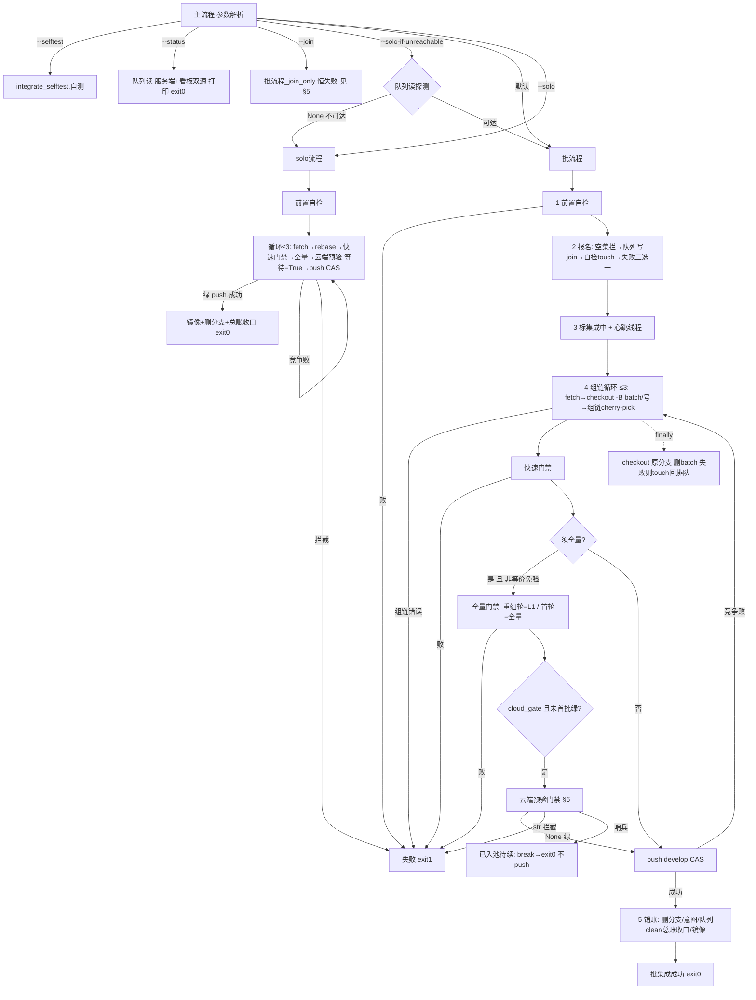

# integrate.py 状态机（状态转移图·876→976）与简化评估

> 976 交付物。对象 = `scripts/integrate.py`（三机每日集成入口·develop 唯一入关口）。
> 本文档 = ①状态转移图（每转移的触发/动作/失败恢复）②关键不变量 ③转移×selftest 覆盖矩阵
> ④演进评估（--wait 归一/solo 并入/拆分方案——976 下半）。代码为准（行号会漂移，函数名锚定）。

## 0. 一分钟速览

- 顶层四入口：`--selftest` / `--status` / `--solo[-if-unreachable]` / `--join`，默认=批流程。
- 两条集成路径：**批流程**（默认·报名→组链入池→门禁→云端预验→push CAS→销账）与 **solo**
  （逃生门·无报名/组链/心跳）。批流程是唯一日常路径（830 并行模型）。
- 云端预验门禁=全局最复杂的子状态机：**池行（排队→执行中→完成/已取消/已踢出）** 与
  **预验分支（推→消费→删/保留）** 两层生命周期耦合，触发多路返回（放行/拦截/哨兵）。
- 唯一不变量（863 立·901 补全·976 收口）：**预验分支删除 ⟺ 池行已确认终态或从未建行**
  ——本轮把「入队」判定拆成三态（ok 建行 / 响应丢失不确定 / 明确拒绝未建），
  堵住 901 立案的「降级 ssh 路径误删分支→runner fetch fatal→975 同步失败告警」缺口。

## 1. 全景图（Mermaid）



## 2. 顶层分发（主流程）

| # | 触发条件 | 动作 | 失败恢复 |
|---|---------|------|---------|
| 0.1 | `--no-cloud-gate` 传入 | 硬拒 exit1（770 用户令） | 提示等待恢复/留档待集成 |
| 0.2 | `--selftest` | 延迟导入 integrate_selftest 跑自测 | 断言失败 exit1 |
| 0.3 | `--status` | 队列读（服务端优先+看板双源）→排序打印 | 只读无失败面 |
| 0.4 | `--solo-if-unreachable`（未带 --solo） | 队列读探测：None→`参数.solo=True` | 可达=正常批路径 |
| 0.5 | `--solo` | solo流程 | 见 §4 |
| 0.6 | `--join` | 批流程_join_only（**恒失败·缺陷在案** 见 §5） | exit1 |
| 0.7 | 默认 | 批流程 | 见 §3 |

参数归一：`--pool-limit` 逗号/多次两形态归一；`fast_lane = not --no-fast-lane`（默认开·941）；
`cloud_gate = not --no-cloud-gate and (默认开 or --cloud-gate)`（默认开·1015）。

## 3. 批流程（日常主路径·830 并行模型）

### 3.1 报名段（[1][2]）

| 转移 | 触发条件 | 动作 | 失败恢复 |
|------|---------|------|---------|
| 前置自检 | 恒 | 分支名合法/工作树干净/已推远端/本地=远端 | 任一败=exit1（信息含处置） |
| 写集空 | `改动文件清单(基线)` 空 | 失败 exit1「空集成」 | — |
| 报名 | 非 dry-run | `队列写("join")` 服务端（v5 后唯一通道） | join 失败=exit1 三选一指引（重试/--solo/--solo-if-unreachable） |
| 报名自检 | join 成功 | 核「自己行=排队」；异常 touch 重试再核 | 仍异常=exit1（防 1017 死等） |
| dry-run | `--dry-run` | 跳过报名写，内存行代用打印 | — |

### 3.2 组链循环（[3][4]·≤最大重试 3 次）

| 转移 | 触发条件 | 动作 | 失败恢复 |
|------|---------|------|---------|
| 建链 | 每次循环 | `fetch`→`checkout -B batch/<号> <最新develop>` | 建链失败=exit1 |
| 组链 | 成员=自己 | cherry-pick（GIT_COMMITTER_DATE 确定性化）；冲突=踢出 | 全踢=exit1；踢出=(批销账跳过·重跑重报) |
| 快速门禁 | 恒跑 | 冲突标记+临时用例+task_board --check | 败=exit1 |
| 等价免验 | `--verified-same-content` 且单飞且写集面 diff 空 | 免重跑全量 | 实质差异=回落全量 |
| 全量门禁 | 须全量 且（fast_lane 或增量须全量） | 重组轮=gate_quick(L1)；首轮=平台分步全量（897） | 败=exit1+成员×写集归因打印 |
| 云端预验 | cloud_gate 且未「首批已绿」 | 见 §6（子状态机） | 哨兵/拦截见下 |
| 全量跳过 | 须全量但 develop 增量纯文档 | 打印跳过（已验部分仍有效） | — |
| push CAS | 门禁全绿 | `git push HEAD:develop`（dry-run 时加 --dry-run） | 竞争败=重组重试（已验基准保留·重组轮只 L1） |
| 竞争耗尽 | 3 次全败且非早退 | exit1（报名仍在·重跑幂等续推） | — |

### 3.3 批流程 × 云端预验门禁（[5.5] 交互）

| 云端预验门禁 返回 | 批流程动作 | 备注 |
|---|---|---|
| None（绿/复用绿/已并入放行） | `云端首批已绿=True`→push develop | 会话内标志防 CAS 重组轮重跑（832） |
| str（红/守卫/超时拦截） | exit1（修复重跑续推） | 已入池结果按内容键复用 |
| 已入池哨兵 | `已入池待续=True`→break→finally（不 touch）→打印续推→exit0 | 仅非 --wait；链与队列行保留 |

### 3.4 收场（[5] 销账 + finally）

| 转移 | 动作 | 失败恢复 |
|------|------|---------|
| finally | 停心跳→checkout 原分支→删 batch 分支 | — |
| 失败恢复 | 非成功且非早退且非 dry-run：`队列写("touch")` 行回排队 | 服务不可达=警告（重跑自愈） |
| 已入池早退 | 打印「已入池」exit0 | 行保持「集成中」（预验信号驱动显示） |
| 销账 | 删远端成员分支→意图 release→清本机缓存→`队列写("clear")`→踢出者 update→总账收口→镜像补推 | 各步失败仅警告（cleanup/对账兜底） |
| 成功 | 打印成员清单+〔通告〕提示 exit0 | — |

## 4. solo / status（旁路）

solo（`--solo`·逃生门·240 立与 `--solo-if-unreachable` 配套）：无报名/组链/心跳/队列行；
就地 rebase 任务分支（不建 batch 分支）；云端预验恒 `等待=True`（**不产生哨兵**——
574「静默 exit 0」当前无复现路径，见 §8/§10.2）；成功=镜像+删远端任务分支+总账收口。

## 5. --join（缺陷在案·976 核实）

`批流程_join_only`：前置自检→fetch→基线→空集检查→**恒失败**。原因：v5（1016）看板直推
废档时本路径的报名写未随服务端迁移（原直推壳恒返回失败）。976 核实保留恒失败行为
（文案沿用），修复或退役=**独立立项 #987**（见 §10.1）。批流程（默认）报名已走服务端 join。

## 6. 云端预验门禁子状态机（核心·§3.3 展开）

### 6.1 函数骨架与三态协议

- 入参：链顶、参数、源分支、等待（--wait 时 True）。
- 返回三态：`None`=放行 push develop；`str`=拦截原因（调用方 exit1）；`已入池哨兵`
  =仅非 --wait 入池成功后（调用方 exit0 待续推）。
- 前置：dry-run 跳过→637 前置检查（链顶含最新 develop·断言①）→830 复用绿查询（命中=放行·
  零推送零入队）→推 `ci/预验-<sha10>` 分支（失败=拦截）。

### 6.2 池入队三态（976 明确化——关键转移）

| 入队响应 | 语义 | 后续 | 分支删除权 |
|---------|------|------|-----------|
| `{"ok": True}` | 行已建（新插/幂等不动/重置重跑——queue_service 统一返回） | 非 --wait=哨兵；--wait=池轮询 | 行确认终态登记后删 |
| `None`（响应丢失/超时/未配置） | **行活跃与否不确定**（请求可能已到达建行） | 降级 ssh | **保留**（保守·误删=runner fetch fatal） |
| `{"ok": False}` 明确拒绝 | 服务端确认未写入（拒绝路径全在 INSERT 前） | 「已并入」=收场不降级；其他=降级 ssh | 照删（无 runner 可认领·保留=死残留） |

### 6.3 池轮询预验（+ssh 直发降级）

| 转移 | 触发条件 | 动作 | 失败恢复 |
|------|---------|------|---------|
| 查询失败 | `/api/state` None×3 | 返回未拿到（False,None） | 调用方降级 ssh |
| 行 miss | 预验任务表无行 | 重新入队（337/830 字段补带·幂等） | 继续轮询 |
| 已取消 | runner 核出源分支已并入 | `已并入收场`：develop 已含链顶=放行 / 未含=拦截 | 即时收场不白等（562） |
| 排队+池全忙 | 池无空闲实例 | 不计池空·继续等（830） | 池忙=正常态 |
| 排队+池有空闲 | 持续 >池空降级秒 | `task_cancel`（1026 防双跑）→ 降级 ssh | 337 限制不含 linux-x86_64=守限制不降级 |
| 执行中 / 完成 | 状态推进 | 执行中=重置计时继续；完成=取 task_result 判绿红 | 红+全点名=披露放行（216）；未点名=硬拦 |
| 总超时 | 240 分钟 | 返回未拿到 | 降级 ssh 或拦截（按限制） |

### 6.4 分支生命周期（863/901 不变量）

```
置位保留预验分支（finally 不删）的三处来路：
  ① 非 --wait 哨兵（入池即返·runner 尚未 fetch）
  ② 337 池守卫拦截（行活·待白名单 runner 上线）
  ③ 降级 ssh / 入队响应丢失（901 补全·行未确认终态）
照删（finally push --delete）的来路：
  ④ 池轮询拿到结论（行完成/已取消——确认终态）
  ⑤ 入队明确拒绝（确认未建行）
  ⑥ 推分支失败/前置失败/dry-run/复用绿（未产生分支或未入池）
分支收口：runner 消费转终态 → branch_cleanup（终态才删·864）兜底；
  或下一轮同 sha 集成池轮询拿结论走 ④。
975 契约：分支删除晚于 runner 消费 ⟺ 不触发「同步失败」连续计数告警。
```

## 7. 转移 × selftest 覆盖矩阵（976 后 50 例）

| 转移 | 覆盖用例（integrate_selftest.py 段） |
|------|-----------------------------------|
| 销账行解析（392） | ⓪ 三例 |
| 解析队列读侧 | ②b 两例 |
| 临时用例拦截（1008/562） | ④ 五例 |
| 预验结果解析（1008） | ⑤ 四例 |
| 池见已取消收场（562） | ⑤b 三例 |
| 池轮询：完成绿/完成红 | ⑤c（绿链/红链） |
| 池轮询：216 点名全中/未点名 | ⑤c 两例 |
| 池轮询：行 miss 重入队 | ⑤c（337/830 字段断言） |
| 池轮询：3 连不可达 / 总超时 | ⑤c 两例 |
| 池轮询：池忙继续等（830） | ⑤c 一例 |
| 池轮询：排队超时取消+降级（1026） / 337 守限制 | ⑤c 两例 |
| 预验前置检查（637） | ⑦ 四例 |
| 门禁：非 --wait 哨兵保留 / --wait 照删（863） | ⑧ 六例 |
| 门禁：dry-run / 830 复用绿 / 推分支失败 | ⑨ 三例 |
| 门禁：337 守卫拦截+保留 | ⑨ 一例 |
| 门禁：901 降级保留（绿）/ 触发失败 / 入队响应丢失 | ⑨ 三例 |
| 门禁：入队明确拒绝照删 / 562 已并入收场 | ⑨ 两例 |
| 归纳件：E2E 红用例行 / 入队载荷 | ⑩ 四例 |

未覆盖（真实链路面·如实声明）：批流程组链循环的 push 竞争重试、心跳线程、销账路径的
真实 git/服务交互——这些属三段外部 IO（git/服务/池），selftest 以 mock 面覆盖其判定
逻辑；REST 竞争语义由云端平台轮转全量兜底（集成后验证）。

## 8. 历史病灶对照（本状态机的演化史）

| 案 | 病灶 | 处置 |
|----|------|------|
| 574 | solo 路径「推预验分支后静默 exit 0」 | 当前代码无复现路径（solo 恒 --wait·无哨兵）；核销建议：实测复核后销账 |
| 830 | 等待批主串行闸门=池并行而入池串行的组合爆炸源 | 砍路径：人人立即组链入池（批主/拼车/接管三面整体退役） |
| 863 | 非 --wait 入池即返→finally 误删预验分支→runner 同步五连失败 | 条件化删除（保留标志）+selftest 六例 |
| 901 | 863 同族残余：降级 ssh 路径照删（池行仍活） | **976 修复**：降级前置位保留+入队三态分流+selftest 锁面 |
| 975 | 五连静默零告警 | 服务端失败计数+告警（吹哨面就位·依赖 863/901 不变量正确） |
| 1016 | 看板直推废档→写侧函数全死+--join/批流程调用残留 | **976 清理**：死代码族删除+报名段等价化简（--join 缺陷另立案） |

## 9. 演进评估（976 下半·做/不做结论）

### 9.1 「--wait 与非 --wait 归一」→ 不做

- 差异本质：非 --wait=入池即返（哨兵+分支保留+exit0）；--wait=挂机到底（结论+删除+push/拦截）。
- 归一形态 A（统一挂机轮询）：可删哨兵协议+保留置位①③，但改变 CLI 语义（命令挂机
  最长 240 分钟）——用户工作模式变化，属用户可见行为面。
- 归一形态 B（统一入池即返）：杀死挂机面，但结论消费需另机制（外部轮询/重跑），
  「绿后自动 push」的 --wait 核心价值丢失。
- **结论：不做**。内部复杂度已由「删除前提不变量+三态协议注释」收敛（863/901 的正解）；
  归一改的是交互语义而非路径数，收益不足抵三机日入口的行为变化风险。可选后续小切片：
  哨兵魔字符串→结构化返回（低风险·低收益·随拆分轮一并）。

### 9.2 「solo 并入主流程」→ 不做（高风险）

- solo 与批的实质差异：就地 rebase（无 batch 分支）/无报名/无心跳/无队列行销账。
- 并入=批流程参数化 5 段（报名/组链/心跳/销账/队列行）——批流程是三机主路径，
  参数化修改=主业回归风险；收益=消 ~90 行重复（push/销账/预验调用面）。
- **结论：不做**（稳大于快）。前置=先完成 §9.3 拆分；独立立项（P2）。

### 9.3 integrate.py 拆分（1522 行>1000 红线）→ 本轮不做·立项建议

- 建议第一刀 `integrate_cloud.py`（云端预验门禁簇 ≈370 行：读CI配置/解析预验结果/
  解析预验红用例们/develop已含链顶/已并入收场/构造预验入队载荷/池轮询预验/预验前置检查/
  查可复用预验绿/已入池哨兵/云端预验门禁）；第二刀 `integrate_queue.py`（队列服务+看板读侧）。
- 风险点：selftest 863/901 段的 monkeypatch 面（7 个绑定）跨模块后须逐改 patch 目标——
  漏改=测试假绿（静默面）；三机日入口=回归窗口。
- 迁移步骤：纯函数簇先移→monkeypatch 目标切换→selftest+gate_quick 双测对拍→
  L2 影响面。回退=单提交 revert（纯移动无数据面）。
- **结论：本轮不做**（高风险大动作）；建议独立轮（可与 9.2 并入同轮）。

### 9.4 本轮已做的最小切片（低风险·含对照验证）

1. 901 修复（降级/入队丢失路径保留）——⑨ 段 mock 对照（修复前该路径会 --delete=测试红）。
2. 入队三态分流（miss 不静默：不确定不当「未建」处置）。
3. 不变量注释统一+哨兵三态协议注释统一。
4. 死代码清理（integrate.py 1626→1525·-101 行）+归纳两件（红用例行/入队载荷）。
5. --join 恒失败与 574 核销建议=呈报立项（§10）。

### 9.5 回退方案

全部改动单提交；`git revert <sha>` 即整体回退（无协议变更/无数据迁移/无外部依赖面）。
行为面回退边界=901 修复与入队三态（仅此两面是对外可见变化，且方向均为修复）。

## 10. 遗留（呈报与立项）

1. **--join 恒失败（1016 遗漏）**：修复（补服务端 join·与批流程报名段归纳）或退役
   （接受即忽略）需一行裁决——976 保持行为不动+如实注释。**已立 #987**。
2. **574 核销**：建议实测复核（三机任一侧跑 solo 观察）后销账或转验证轮。
3. **拆分与 solo 并入**（9.2/9.3）=独立立项建议。
4. **残留分支清理债务**：保留面分支（①③来路）依赖 branch_cleanup「终态才删」——
   无终态且未并入的残留=保守保留（无自动回收）——观测面=cleanup 演练清单，够量再立项。
5. **win/linux 复验点名判定段历史行为差异**（976 复核·未收敛·原因=非等价）：串行输出
   无 ✗ 行但 rc≠0（解析空异常）时——win 分步=披露放行、linux 串行=拦截（保守）。
   两段含 591-a/564-a 两次补接的差异；收敛须一并裁决「解析空=放行 or 拦」=行为修正
   非等价化简，留独立轮（win 侧当前为宽松面·疑漏拦——本轮的归纳件只抽共用的
   ✗ 行解析、判定段各留原样正是为此）。
